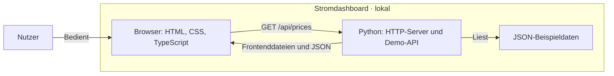

# strom — Stromdaten als Cloud-Lernprojekt

## Overview

Ein kleines Stromdashboard, an dem ich den Aufbau und Betrieb einer Cloud-Anwendung Schritt für Schritt lerne. Ich habe Strom als Thema gewählt, weil mich Energie interessiert und mit [Energy-Charts](https://api.energy-charts.info/) eine öffentlich zugängliche Datenquelle zur Verfügung steht.

## Features

- Tagesdiagramm mit 24 erfundenen Strompreisen.
- Aufklappbare JSON-Ansicht der geladenen Daten.
- Systemtour mit D2-Diagrammen zu Architektur, Datenfluss und Deployment.

## Tech Stack

| Bereich | Technologie | Verwendung |
| --- | --- | --- |
| Frontend | HTML, CSS, TypeScript | Oberfläche, API-Abfrage und Diagramm; ohne UI-Framework |
| Backend | Python 3.11+, Standardbibliothek | Lokaler HTTP-Server, Demo-API und Dateiauslieferung |
| Daten | JSON | Fest hinterlegte Beispieldaten; noch keine Datenbank |
| Build | Node.js 24+, npm, TypeScript-Compiler | Übersetzt das Frontend; Node.js ist kein Backend |
| Tests | Python `unittest` und `http.client` | HTTP-Integrationstest gegen einen gestarteten Python-Server |
| Dokumentation | D2 0.9.0, Mermaid | Ausführliche Zielbilder und kompakter Architekturüberblick |

### Projektstruktur

Versionierte Dateien im Repository:

```text
strom-dashboard/
├── api/
│   ├── README.md                      # HTTP-Vertrag
│   └── demo-prices.json               # Beispieldaten
├── assets/
│   └── fonts/
│       ├── FuzzyBubbles-Regular.ttf   # Lokal ausgelieferte Schrift
│       └── OFL.txt                    # Schriftlizenz
├── backend/
│   └── server.py                      # Python-Webserver und Demo-API
├── diagrams/
│   ├── database.d2                    # Datenmodell: Quelle
│   ├── database.svg                   # Datenmodell: Grafik
│   ├── dataflow.d2                    # Datenfluss: Quelle
│   ├── dataflow.svg                   # Datenfluss: Grafik
│   ├── deployment.d2                  # Deployment: Quelle
│   ├── deployment.svg                 # Deployment: Grafik
│   ├── system.d2                      # Systemarchitektur: Quelle
│   └── system.svg                     # Systemarchitektur: Grafik
├── frontend/
│   └── main.ts                        # Daten laden, prüfen und zeichnen
├── tests/
│   └── contract_test.py               # HTTP-Integrationstest
├── .gitignore                         # Lokale Dateien ausschließen
├── README.md                          # Projektübersicht
├── index.html                         # Beide Ansichten
├── styles.css                         # Darstellung und Layout
├── package.json                       # npm-Skripte und Build-Abhängigkeiten
├── package-lock.json                  # Festgeschriebene Abhängigkeiten
└── tsconfig.json                      # TypeScript-Konfiguration
```

## Getting Started

Voraussetzungen: Python 3.11+ und Node.js 24+ mit npm.

Im Projektordner ausführen:

```sh
npm ci
npm run build
npm start
```

Anschließend [localhost:4176](http://127.0.0.1:4176) öffnen. Mit Strg+C beenden.

**Prüfen:** `npm run check` für die TypeScript-Typprüfung, `npm test` für Build und HTTP-Tests.

## Engineering & Quality

Die sieben Referenzen geben meiner persönlichen Weiterentwicklung eine Richtung. Ich möchte die dahinterstehenden Prinzipien an echten Projekten selbst anwenden, Erfahrungen sammeln und dadurch die Qualität meiner Arbeit Schritt für Schritt verbessern.

| Approach | Implementation | Evidence |
| --- | --- | --- |
| **SOLID** | Getrennte Verantwortlichkeiten für Frontend, HTTP-Server und API-Vertrag. Eine vollständige Bewertung der SOLID-Prinzipien steht aus. | [Frontend](frontend/main.ts), [Backend](backend/server.py), [API-Vertrag](api/README.md) |
| **Test Pyramid** | HTTP-Integrationstest vorhanden. Separate Unit- und End-to-End-Tests sind noch nicht umgesetzt. | [Integrationstest](tests/contract_test.py), [Testbefehl](package.json) |
| **CI/CD** | Build, Typprüfung und Test sind lokal ausführbar. Automatisierte CI und Deployment sind geplant. | [npm-Skripte](package.json); noch kein CI/CD-Workflow vorhanden |
| **OWASP LLM Top 10** | N/A — die Anwendung verwendet keine LLM-Funktionalität. | Aktueller Funktionsumfang: [Frontend](frontend/main.ts), [Backend](backend/server.py) |
| **NIST CSF 2.0** | Noch zu bewerten. Eine Zuordnung vorhandener Maßnahmen zum Framework steht aus. | Ausgangspunkte: [explizite Dateifreigabe und lokale Bind-Adresse](backend/server.py), [HTTP-Prüfungen](tests/contract_test.py) |
| **ISO 27001** | Noch zu bewerten. Es gibt keine dokumentierte Zuordnung zu Controls und kein projektspezifisches ISMS. | To be assessed |
| **C4 Model** | Vereinfachter, an C4 orientierter Überblick über die aktuellen Bausteine; kein vollständiger Satz von C4-Diagrammen. | [Ausführliches D2-Zielbild](diagrams/system.d2)<br>[Architecture Snapshot](#architecture-diagram)<br>↓ ↓ ↓ ↓ ↓ ↓ ↓ ↓ ↓ ↓ |

<a name="architecture-diagram"></a>



### Architecture Snapshot

Aktueller lokaler Stand: Das Python-Backend liefert die Frontenddateien aus und stellt die Demo-API bereit. Es liest eine JSON-Datei; eine externe Datenquelle wird noch nicht abgefragt.

## License

Für den Projektcode wurde noch keine Lizenz festgelegt. Die unveränderte Schrift [Fuzzy Bubbles](https://github.com/google/fonts/tree/main/ofl/fuzzybubbles) wird unter der [SIL Open Font License 1.1](assets/fonts/OFL.txt) mitgeliefert.
