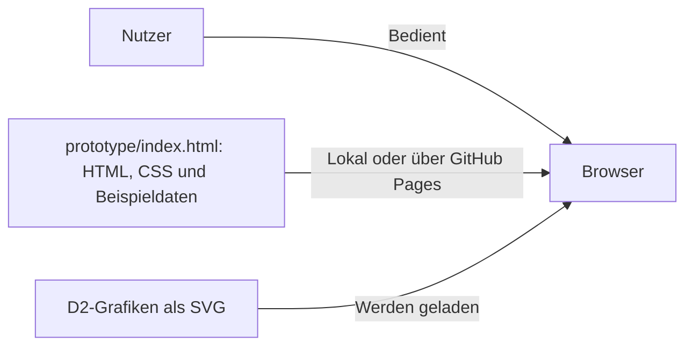

# strom — Energiedaten als Cloud-Lernprojekt

## Overview

Eine visuelle Vorlage für ein kleines Energiedashboard, das ich selbst von Grund auf programmieren und in der Cloud betreiben möchte. Energie interessiert mich besonders; öffentlich zugängliche Daten wie die von [Energy-Charts](https://api.energy-charts.info/) bieten dafür eine passende Grundlage.

[Visuelles Zielbild öffnen ↗](https://crnly.github.io/strom-dashboard/prototype/)

## Features

- Statisches Zielbild im Sketch-Design mit einer Auswahl zwischen Strom und Erdöl (Brent).
- Tagesdiagramm für Strom und Monatsverlauf für Brent, jeweils mit erfundenen Preisen und JSON-Ansicht.
- Systemtour mit D2-Zielbildern zu Architektur, Datenfluss, Datenmodell und Deployment.

## Tech Stack

<details>
<summary>Technologien anzeigen</summary>

| Bereich | Technologie | Verwendung |
| --- | --- | --- |
| Vorlage | HTML, CSS | Statische Ansichten und Auswahl ohne JavaScript |
| Beispieldaten | JSON, SVG | Eingebettete Daten und Preisdiagramme |
| Zielbilder | D2, SVG | Diagrammquellen und gerenderte Grafiken |
| Dokumentation | Markdown, Mermaid | Projektübersicht und kompakter Architekturüberblick |
| Hosting | GitHub Pages | Online-Vorschau der statischen Vorlage |

</details>

### Projektstruktur

<details>
<summary>Projektdateien anzeigen</summary>

Versionierte Dateien im Repository:

```text
strom-dashboard/
├── prototype/
│   ├── diagrams/
│   │   ├── database.d2       # Datenmodell: Quelle
│   │   ├── database.svg      # Datenmodell: Grafik
│   │   ├── dataflow.d2       # Datenfluss: Quelle
│   │   ├── dataflow.svg      # Datenfluss: Grafik
│   │   ├── deployment.d2     # Deployment: Quelle
│   │   ├── deployment.svg    # Deployment: Grafik
│   │   ├── system.d2         # Systemarchitektur: Quelle
│   │   └── system.svg        # Systemarchitektur: Grafik
│   ├── index.html           # Statisches Zielbild mit eingebetteter Schrift
│   └── OFL.txt              # Schriftlizenz
├── .gitignore               # Lokale Dateien ausschließen
└── README.md                # Projektübersicht
```

</details>

## Getting Started

Die Online-Vorlage ist über den Link oben erreichbar. Für die lokale Ansicht das Repository herunterladen und `prototype/index.html` im Browser öffnen. Ein Build oder Backend wird dafür nicht benötigt.

## Engineering & Quality

Die sieben Referenzen geben meiner persönlichen Weiterentwicklung eine Richtung. Ich möchte die dahinterstehenden Prinzipien an echten Projekten selbst anwenden, Erfahrungen sammeln und dadurch die Qualität meiner Arbeit Schritt für Schritt verbessern.

- **SOLID:** Verantwortlichkeiten klar trennen und Code verständlich erweiterbar halten.
- **Test Pyramid:** Funktionen und Schnittstellen gezielt testen. Tests entstehen mit der eigenen Umsetzung.
- **CI/CD:** Änderungen automatisiert prüfen und reproduzierbar veröffentlichen. Die statische Vorlage wird bereits über GitHub Pages veröffentlicht; eine Anwendungspipeline entsteht mit der eigenen Umsetzung.
- **OWASP LLM Top 10:** Sicherheitsrisiken berücksichtigen, sobald LLM-Funktionen hinzukommen. Die Vorlage verwendet keine LLMs.
- **NIST CSF 2.0:** Sicherheitsrisiken systematisch betrachten und passende Maßnahmen ableiten. Die Bewertung steht noch aus.
- **ISO 27001:** Informationssicherheit nachvollziehbar organisieren und dokumentieren. Die Bewertung steht noch aus.
- **C4 Model:** Aufbau und Zusammenhänge des Systems verständlich darstellen: [Ausführliches D2-Zielbild](prototype/diagrams/system.d2) für den geplanten Ausbau und [Vereinfachter Architecture Snapshot (Mermaid)](#architecture-diagram) der aktuellen Vorlage.<br>↓ ↓ ↓ ↓ ↓ ↓ ↓ ↓ ↓ ↓

<a name="architecture-diagram"></a>



## License

Für den Projektcode wurde noch keine Lizenz festgelegt. Die eingebettete Schrift [Fuzzy Bubbles](https://github.com/google/fonts/tree/main/ofl/fuzzybubbles) wird unter der [SIL Open Font License 1.1](prototype/OFL.txt) mitgeliefert.
