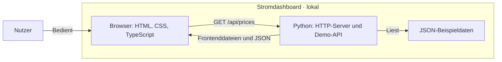

# strom — Stromdaten als Cloud-Lernprojekt

## Overview

**Status: In Entwicklung · läuft lokal mit Beispieldaten.**

Ein kleines Stromdashboard mit TypeScript-Frontend und Python-Backend. Das Lernprojekt wächst schrittweise zu einem reproduzierbaren Cloud-Deployment. Die Anwendungslogik bleibt bewusst klein; der Schwerpunkt liegt auf verständlichen Schnittstellen, SQL, Docker, Linux und Terraform.

Aktuell gibt es keine echten Stromdaten, Datenbank oder öffentliche Live-Anwendung. Die ausführlichen D2-Diagramme im Tab „So funktioniert’s“ zeigen den geplanten Zielzustand. Der [Architecture Snapshot](#architecture-diagram) unten zeigt dagegen den bereits implementierten Aufbau.

## Features

- Tagesdiagramm mit 24 ausdrücklich als erfunden gekennzeichneten Stundenpreisen.
- Aufklappbare JSON-Ansicht der geladenen Daten.
- Validierung der API-Antwort im Frontend und sichtbare Meldungen bei Ladefehlern.
- Zweiter Tab mit Erklärungen zu Architektur, Datenfluss, Datenmodell, Deployment und Betrieb.
- Vier D2-Diagramme mit verlinkten Quelldateien und SVG-Vollansichten.
- Lokaler Health-Endpunkt unter `/healthz`; er prüft ausschließlich den Webprozess.

### Geplant

- [ ] Echte Stromdaten aus einer öffentlichen API abrufen.
- [ ] Preisintervalle in PostgreSQL speichern und anzeigen.
- [ ] Anwendung und Datenbank mit Docker Compose betreiben.
- [ ] Cloud-Infrastruktur mit Terraform bereitstellen und auf Linux deployen.
- [ ] Tests und Deployment mit GitHub Actions automatisieren; Betrieb und Wiederherstellung dokumentieren.

Kubernetes gehört vorerst nicht zum Umfang. Wir pflegen ein Python-Backend. Ein späterer Sprachwechsel kann auf dem dokumentierten [API-Vertrag](api/README.md) aufbauen, erfordert aber eine neue Backend-Implementierung mit passender Fachlogik und gegebenenfalls kompatiblem Datenbankschema.

## Tech Stack

| Bereich | Technologie | Verwendung |
| --- | --- | --- |
| Frontend | HTML, CSS, TypeScript | Oberfläche, API-Abfrage und Diagramm; ohne UI-Framework |
| Backend | Python 3.11+, Standardbibliothek | Lokaler HTTP-Server, Demo-API und Dateiauslieferung |
| Daten | JSON | Fest hinterlegte Beispieldaten; noch keine Datenbank |
| Build | Node.js 24+, npm, TypeScript-Compiler | Übersetzt das Frontend; Node.js ist kein Backend |
| Tests | Python `unittest` und `http.client` | HTTP-Integrationstest gegen einen gestarteten Python-Server |
| Dokumentation | D2 0.9.0, Mermaid | Ausführliche Zielbilder und kompakter Architekturüberblick |

Das UI übernimmt den Sketch-Stil von D2 Theme 101 (Orange Creamsicle). Die Überschriftenschrift Fuzzy Bubbles wird lokal ausgeliefert; Fließtext und JSON verwenden Systemschriften.

### Projektstruktur

```text
strom-dashboard/
├── index.html                 # Beide Ansichten
├── styles.css                 # Layout und Sketch-Design
├── frontend/main.ts           # Daten laden, prüfen und zeichnen
├── backend/server.py          # Python-Webserver und Demo-API
├── assets/fonts/              # Lokale Schrift und zugehörige Lizenz
├── api/
│   ├── README.md              # HTTP-Vertrag
│   └── demo-prices.json        # 24 erfundene Stundenwerte
├── tests/contract_test.py      # HTTP-Integrationstest
├── diagrams/                  # D2-Quellen und gerenderte SVGs
├── package.json
├── package-lock.json
└── tsconfig.json
```

`dist/` und `node_modules/` werden lokal erzeugt und nicht eingecheckt.

## Getting Started

Voraussetzungen: Python 3.11+ und Node.js 24+ mit npm.

Im Projektordner ausführen:

```sh
npm ci
npm run build
npm start
```

Anschließend [localhost:4176](http://127.0.0.1:4176) öffnen. Mit Strg+C beenden.

**Prüfen:** `npm run check` für die TypeScript-Typprüfung, `npm test` für Build und HTTP-Tests.

## Engineering & Quality

Die sieben Referenzen dienen als Orientierung. Die Tabelle nennt vorhandene Nachweise und kennzeichnet offene Implementierungen und Bewertungen.

| Approach | Implementation | Evidence |
| --- | --- | --- |
| **SOLID** | Getrennte Verantwortlichkeiten für Frontend, HTTP-Server und API-Vertrag. Eine vollständige Bewertung der SOLID-Prinzipien steht aus. | [Frontend](frontend/main.ts), [Backend](backend/server.py), [API-Vertrag](api/README.md) |
| **Test Pyramid** | HTTP-Integrationstest vorhanden. Separate Unit- und End-to-End-Tests sind noch nicht umgesetzt. | [Integrationstest](tests/contract_test.py), [Testbefehl](package.json) |
| **CI/CD** | Build, Typprüfung und Test sind lokal ausführbar. Automatisierte CI und Deployment sind geplant. | [npm-Skripte](package.json); noch kein CI/CD-Workflow vorhanden |
| **OWASP LLM Top 10** | N/A — die Anwendung verwendet keine LLM-Funktionalität. | Aktueller Funktionsumfang: [Frontend](frontend/main.ts), [Backend](backend/server.py) |
| **NIST CSF 2.0** | Noch zu bewerten. Eine Zuordnung vorhandener Maßnahmen zum Framework steht aus. | Ausgangspunkte: [explizite Dateifreigabe und lokale Bind-Adresse](backend/server.py), [HTTP-Prüfungen](tests/contract_test.py) |
| **ISO 27001** | Noch zu bewerten. Es gibt keine dokumentierte Zuordnung zu Controls und kein projektspezifisches ISMS. | To be assessed |
| **C4 Model** | Vereinfachter, an C4 orientierter Überblick über die aktuellen Bausteine; kein vollständiger Satz von C4-Diagrammen. | [Ausführliches D2-Zielbild](diagrams/system.d2)<br>[Architecture Snapshot](#architecture-diagram)<br>↓ ↓ ↓ ↓ ↓ ↓ ↓ ↓ ↓ ↓ |

<a name="architecture-diagram"></a>



### Architecture Snapshot

Aktueller lokaler Stand: Das Python-Backend liefert die Frontenddateien aus und stellt die Demo-API bereit. Es liest eine JSON-Datei; eine externe Datenquelle wird noch nicht abgefragt.

## License

Für den Projektcode wurde noch keine Lizenz festgelegt. Die unveränderte Schrift [Fuzzy Bubbles](https://github.com/google/fonts/tree/main/ofl/fuzzybubbles) wird unter der [SIL Open Font License 1.1](assets/fonts/OFL.txt) mitgeliefert.
